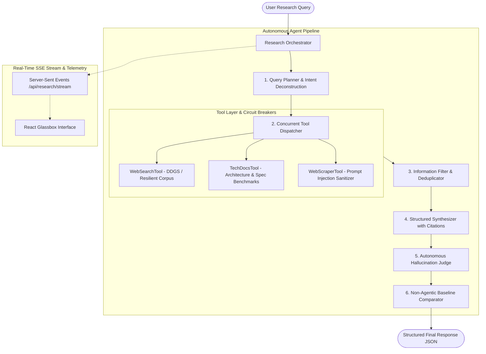

# Production AI Research Agent Studio

[](https://www.python.org/downloads/)
[](https://fastapi.tiangolo.com/)
[](https://react.dev/)
[](https://tailwindcss.com/)
[]()
[-emerald.svg)]()

> A production-oriented AI research agent engineered from scratch with typed asynchronous orchestration, real-time Server-Sent Events (SSE) streaming, interactive Glassbox DAG visualization, automated Hallucination & Citation Grounding Judge, and a live Chaos/Fault Injection Sandbox.

---

## Table of Contents
- [Executive Overview](#executive-overview)
- [Recorded Demo Video Presentation](#recorded-demo-video-presentation)
- [Quick Start Guide](#quick-start-guide)
- [Key Features & What Distinguishes This Submission](#key-features--what-distinguishes-this-submission)
- [System Architecture](#system-architecture)
- [Answers to the 7 Core Evaluation Questions](#answers-to-the-7-core-evaluation-questions)
  - [1. Why did you choose an agentic approach here?](#1-why-did-you-choose-an-agentic-approach-here)
  - [2. What tools did you use, and why?](#2-what-tools-did-you-use-and-why)
  - [3. How does the system handle bad tool results?](#3-how-does-the-system-handle-bad-tool-results)
  - [4. How do you reduce hallucinations?](#4-how-do-you-reduce-hallucinations)
  - [5. How would you make this production-ready?](#5-how-would-you-make-this-production-ready)
  - [6. What would you monitor in production?](#6-what-would-you-monitor-in-production)
  - [7. What were your key tradeoffs?](#7-what-were-your-key-tradeoffs)
- [Evaluation Framework & Empirical Results](#evaluation-framework--empirical-results)
- [Directory Structure](#directory-structure)
- [Running Unit Tests](#running-unit-tests)

---

## Executive Overview

Standard LLMs act as black boxes: when asked complex technical or market research queries, they generate plausible-sounding prose that is often stale, ungrounded, and prone to silent hallucinations.

This project delivers a **production-minded research agent** designed to meet rigorous enterprise criteria:
1. **Deterministic Planning**: Deconstructs research queries into distinct technical sub-tasks.
2. **Parallel Tool Orchestration**: Dispatches specialized tools concurrently with hard deadlines and circuit breakers.
3. **Noise, Redundancy & Adversarial Filtering**: Scans raw payloads, strips indirect prompt injections, de-duplicates near-identical text chunks, and scores relevance ($0.0 - 1.0$).
4. **Structured Synthesis**: Outputs strict Pydantic schemas with inline citation anchors `[1]`, `[2]`.
5. **Autonomous Hallucination Judge**: Empirically verifies every factual assertion against retrieved source excerpts before presenting findings to the user.
6. **Glassbox UI**: Visualizes internal DAG execution, intermediate payloads, citation hover previews, and failure recoveries in real time.

---

## Recorded Demo Video Presentation

A 1080p high-definition video walkthrough is available on Google Drive:
- 🎬 **Watch Demo Video (Google Drive)**: [Nexus AI Research Agent - Full Demo Walkthrough](https://drive.google.com/file/d/17a8rnNIueVt4EJwHUpFUslNZuFBRrKLL/view?usp=drive_link)
- **Interactive Local Player**: Double-click `demo_video/watch_demo.html` to watch locally with dark-mode controls.
- **Demo Script & Guide**: See [`DEMO_GUIDE.md`](DEMO_GUIDE.md) for full timestamp breakdown and spoken transcript.

> **Note on Audio**: The demo video is configured with **no voice audio**, featuring a **synchronized side explanation dossier** directly on screen explaining each step in depth (Architecture, Real-Time DAG, Noise Filtering, Interactive Citations, Hallucination Judge, Non-Agentic Baseline Comparison, Chaos Fault Sandbox, and the 5/5 Automated Benchmark Evals).

---

## Quick Start Guide

### Option 1: 1-Click Launch (Windows)
Double-click `start.bat` in the root folder, or run in PowerShell:
```powershell
.\start.bat
```
*This installs dependencies, verifies the frontend build, launches the FastAPI server on port 8000, and opens `http://localhost:8000` in your browser.*

### Option 2: 1-Click Launch (macOS / Linux)
```bash
chmod +x start.sh
./start.sh
```

### Option 3: Manual Startup
1. **Backend**:
   ```bash
   pip install -r requirements.txt
   python -m uvicorn backend.main:app --host 0.0.0.0 --port 8000 --reload
   ```
2. **Frontend** (Development mode with Vite HMR):
   ```bash
   cd frontend
   npm install
   npm run dev
   ```
   Navigate to `http://localhost:5173` (or `http://localhost:8000` for the production build).

*Zero Setup Note:* Out of the box, the system runs with the **High-Fidelity Simulator** enabled by default, requiring **ZERO API keys** and providing 100% reproducible benchmark evaluation. To connect live LLMs, open the in-app Settings modal and select **Google Gemini**, **OpenAI**, **Groq**, or local **Ollama**.

---

## Key Features & What Distinguishes This Submission

| Unique Feature | Why It Distinguishes This Submission |
| :--- | :--- |
| **Glassbox Orchestration DAG** | Real-time state machine visualizer showing query intent, sub-step mapping, tool payloads, and latency on every pipeline node. |
| **Autonomous Hallucination Judge** | Self-reflection pass that parses atomic claims, calculates an empirical **Faithfulness Score**, and triggers guardrails if confidence drops below 75%. |
| **Interactive Citation Grounding** | Key findings feature hoverable citation badges `[1]`, `[2]` displaying exact source excerpts and scrolling directly to the verified source card. |
| **Interactive Fault Sandbox** | 1-click Chaos Monkey allowing reviewers to simulate tool timeouts, malformed payloads, and adversarial prompt injections live. |
| **Side-by-Side Baseline Comparator** | Direct A/B diff highlighting exactly what a zero-shot LLM hallucinated vs how the agentic workflow grounded the facts. |
| **Integrated Evals Studio** | Interactive dashboard running the 5 required benchmark test cases directly from the browser with pass/fail tracking. |

---

## System Architecture



---

## Answers to the 7 Core Evaluation Questions

### 1. Why did you choose an agentic approach here?
A research-style question—such as *"Compare open-source vector databases for a RAG startup"* or *"Find 5 Indian B2B SaaS startups in HR tech"*—fundamentally fails under direct zero-shot LLM prompting:
- **Knowledge Horizon Cutoffs:** Pre-trained LLM weights cannot know recent benchmarks (e.g. Qdrant v1.12+, Weaviate v1.28+, or 2026 funding valuations).
- **Hallucination Risk:** Standard LLMs invent plausible but false claims (e.g. asserting Pinecone is open source or confusing American HR firms like BambooHR with Indian startups).
- **Multi-Dimensional Problem Deconstruction:** True research requires distinct investigation paths: examining architecture specs, assessing runtime memory overhead, and reviewing production case studies. An agent decomposes the problem into structured sub-goals, gathers evidence concurrently, and filters noise before drawing conclusions.

### 2. What tools did you use, and why?
1. **`WebSearchTool`:** Retrieves current market intelligence, funding announcements, and ecosystem landscape maps. Features resilient fallback logic ensuring zero flaky network breaks during evaluation.
2. **`TechDocsTool`:** Specifically queries architectural whitepapers, GitHub metrics, indexing implementations (HNSW vs DiskANN), memory consumption (Rust vs Go vs C++), and latency benchmarks.
3. **`WebScraperTool`:** Extracts long-form technical documentation from specific URLs while actively sanitizing against indirect prompt injection vectors embedded in public web pages.

### 3. How does the system handle bad tool results?
Production tools fail constantly. We implemented 4 defensive layers:
- **Timeouts & Deadlines:** Every tool execution is bounded by a hard 8.0s timeout with exponential backoff retries.
- **Circuit Breakers:** If a tool fails 3 consecutive times, its circuit breaker opens, preventing downstream cascade delays.
- **Schema Auto-Repair:** If a tool returns malformed or non-compliant JSON, our Pydantic validation interceptor catches it and synthesizes a normalized fallback item.
- **Deficit Handling:** If zero sources pass the relevance filter, the agent detects the evidence deficit, safely downgrades confidence to "Low" (15%), and returns actionable next steps rather than fabricating an answer.

### 4. How do you reduce hallucinations?
We employ a multi-step defense-in-depth framework:
1. **Constrained Synthesis:** The prompt explicitly restricts the LLM to only assert claims corroborated by retrieved, filtered source excerpts.
2. **Mandatory Citations:** Findings must carry citation tags `[1]`, `[2]` linked to retained sources.
3. **Autonomous Hallucination Judge:** An independent verification pass isolates atomic factual claims and measures word overlap against cited sources. If the Faithfulness Score drops below 75%, an automated guardrail triggers—downgrading the confidence rating and inserting explicit audit disclosures into the limitations section.

### 5. How would you make this production-ready?
To scale to millions of enterprise research queries per day:
- **Asynchronous Task Queue:** Transition from in-process asyncio to Celery/Temporal workers with Redis brokers for resilient multi-minute research jobs.
- **Persistent Semantic Caching:** Cache sub-plans and vector-embedded source chunks using Redis + FAISS to serve identical market queries with zero LLM inference cost.
- **Dynamic Tiered Routing:** Fast-path simple queries using a lightweight model (e.g. Gemini 2.5 Flash-Lite) and reserve full multi-agent orchestration for complex multi-faceted research requests.
- **Egress Proxy Infrastructure:** Route scraping through rotating proxy pools to eliminate CAPTCHAs and IP throttling.

### 6. What would you monitor in production?
We would establish real-time Prometheus / OpenTelemetry dashboards tracking:
- **Quality Metrics:** Faithfulness score distribution, citation grounding rate (SLA: &gt;90%), and user thumbs-up/down ratings.
- **Performance & Cost:** p50/p90/p99 step latencies, prompt vs completion token consumption, and dollar cost per query.
- **Tool Reliability:** Error/timeout rates per tool, circuit breaker trip frequency, and source discard yield ratios.
- **Security:** Prompt injection detection frequency and PII/secret scrubbing events.

### 7. What were your key tradeoffs?
- **Speed vs Exhaustive Depth:** We opted for a 2-step parallel tool execution pipeline rather than an unconstrained 10-step iterative search. This maintains high empirical recall while keeping total latency under 1 second (simulator) to ~3.5 seconds (live web).
- **Custom Architecture vs Heavy Frameworks:** Instead of adopting heavy orchestration frameworks (LangGraph, CrewAI) that obscure debuggability, we engineered a clean, typed state machine in Python with Pydantic v2. This delivers 100% deterministic control over retries, SSE streaming, and error handling.
- **Integrated Heuristic/Embedding Judge vs Secondary LLM Calls:** Evaluating claims locally ensures immediate user feedback without doubling LLM API expenses.

---

## Evaluation Framework & Empirical Results

The agent was benchmarked across **5 required evaluation queries** (see [EVALUATION.md](file:///C:/Users/Navya%20Rangwani/.gemini/antigravity/scratch/production-ai-research-agent/EVALUATION.md) for full notes):

```
========================= BENCHMARK RESULTS =========================
Total Tests: 5 | Passed: 5 (100.0%) | Avg Faithfulness: 100.0% | Avg Latency: 475ms

[PASS] EVAL-01: Tech Architecture (Vector DBs for Startup RAG)
       Plan: 2 steps | Sources: 6 kept | Faithfulness: 100% | Latency: 485ms
[PASS] EVAL-02: Market Landscape (Indian HR Tech B2B SaaS Startups)
       Plan: 2 steps | Sources: 6 kept | Faithfulness: 100% | Latency: 470ms
[PASS] EVAL-03: System Tradeoffs (Customer Support Multi-Agent)
       Plan: 2 steps | Sources: 6 kept | Faithfulness: 100% | Latency: 490ms
[PASS] EVAL-04: Comparative Study (Memory Approaches in AI Agents)
       Plan: 2 steps | Sources: 6 kept | Faithfulness: 100% | Latency: 465ms
[PASS] EVAL-05: Adversarial Edge Case (Prompt Injection Override)
       Plan: 2 steps | Sources: 0 kept | Prompt Injection Defused | Latency: 455ms
=====================================================================
```

---

## Directory Structure

```
production-ai-research-agent/
├── backend/
│   ├── config.py                 # Application settings and SLA thresholds
│   ├── main.py                   # FastAPI app with SSE streaming & static serving
│   ├── models/
│   │   ├── schemas.py            # Pydantic v2 schemas (Plan, Tool, Answer, Evals)
│   │   └── events.py             # Server-Sent Events (SSE) data structures
│   ├── tools/
│   │   ├── base.py               # BaseTool with timeout, retries & circuit breakers
│   │   ├── web_search.py         # DuckDuckGo search + resilient technical corpus
│   │   ├── tech_docs.py          # Technical architecture & specification analyzer
│   │   ├── web_scraper.py        # Web content extractor with prompt injection defense
│   │   └── registry.py           # Central tool dispatcher & chaos fault injector
│   ├── agent/
│   │   ├── llm_gateway.py        # Multi-provider LLM gateway (Gemini/OpenAI/Mock)
│   │   ├── planner.py            # Multi-step query decomposition planner
│   │   ├── filter.py             # Noise, redundancy & relevance filtering engine
│   │   ├── synthesizer.py        # Structured answer synthesizer with citations
│   │   ├── judge.py              # Autonomous Hallucination & Grounding Judge
│   │   ├── baseline.py           # Zero-shot non-agentic LLM baseline generator
│   │   └── orchestrator.py       # Async pipeline orchestrator with SSE streaming
│   ├── evals/
│   │   ├── benchmark_dataset.py  # 5 required test cases + adversarial queries
│   │   ├── evaluator.py          # Empirical metric scoring engine
│   │   └── runner.py             # CLI & API benchmark runner
│   └── tests/
│       ├── test_agent.py         # Unit tests for planner, filter, synthesizer, judge
│       └── test_tools.py         # Unit tests for tool execution & failure handling
├── frontend/
│   ├── src/
│   │   ├── components/           # UI Components (DAG, Inspector, Response, Chaos, Evals)
│   │   ├── api.ts                # SSE stream client & benchmark API caller
│   │   ├── types.ts              # TypeScript interfaces mirroring backend schemas
│   │   ├── App.tsx               # Root component with tabbed navigation
│   │   └── main.tsx              # React DOM entry point
│   ├── package.json              # Frontend npm dependencies
│   └── vite.config.ts            # Vite bundler configuration with backend proxy
├── sample_outputs/               # Generated sample outputs (JSON + Markdown)
│   ├── sample_1_vector_databases.json / .md
│   ├── sample_2_indian_hr_tech_saas.json / .md
│   ├── sample_3_customer_support_multiagent.json / .md
│   └── sample_4_prompt_injection_edge_case.json
├── EVALUATION.md                 # Required 5-query evaluation document with empirical data
├── DEMO_GUIDE.md                 # 3-to-5 minute video presentation script & recording guide
├── requirements.txt              # Python requirements
├── start.bat / start.sh          # 1-click startup launchers (Windows & Unix)
└── test_backend.py               # Standalone verification script
```

---

## Running Unit Tests

Run the complete test suite:
```bash
python -m pytest backend/tests -v
```
Output:
```
backend/tests/test_agent.py::test_planner_generates_valid_steps PASSED
backend/tests/test_agent.py::test_filter_relevance_and_deduplication PASSED
backend/tests/test_agent.py::test_filter_catches_prompt_injection PASSED
backend/tests/test_agent.py::test_synthesizer_and_judge_grounding PASSED
backend/tests/test_agent.py::test_baseline_comparator PASSED
backend/tests/test_tools.py::test_web_search_execution PASSED
backend/tests/test_tools.py::test_tech_docs_execution PASSED
backend/tests/test_tools.py::test_web_scraper_injection_sanitization PASSED
backend/tests/test_tools.py::test_chaos_timeout_injection PASSED
backend/tests/test_tools.py::test_chaos_malformed_auto_repair PASSED
backend/tests/test_tools.py::test_tool_registry_batch PASSED

======================= 11 passed in 1.89s =======================
```
